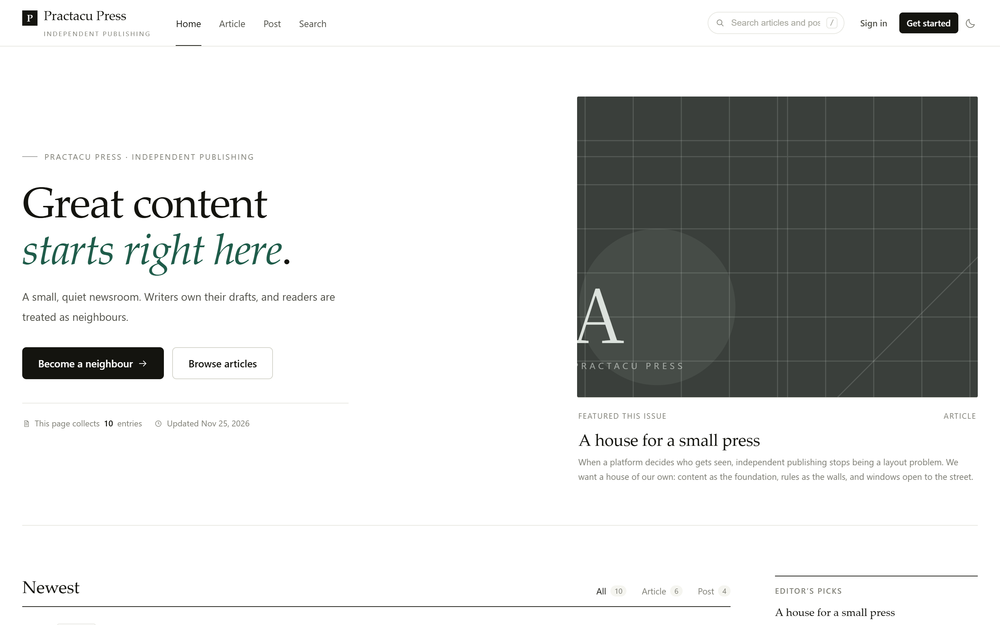
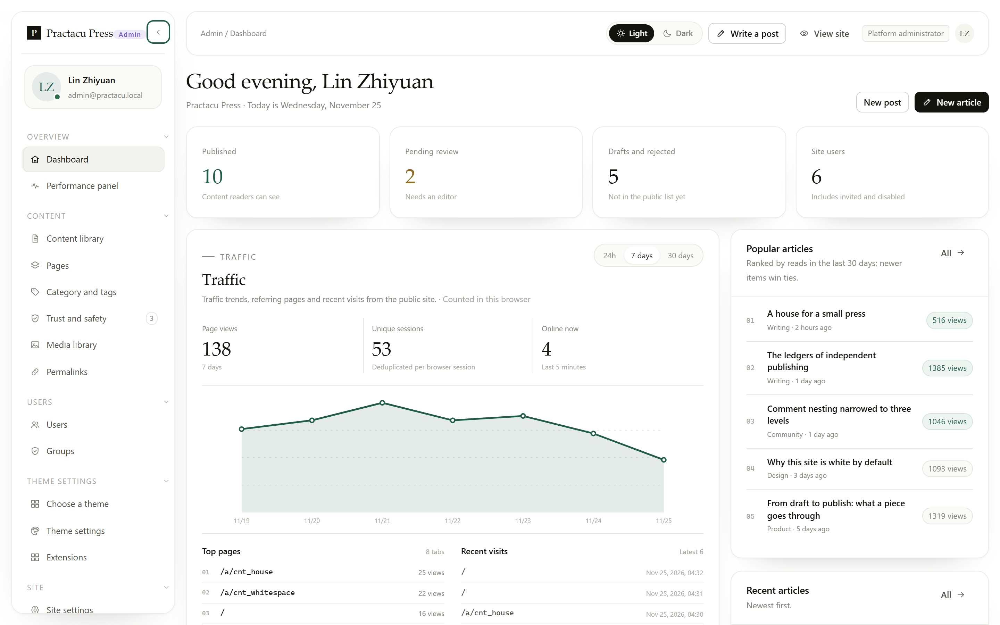

# Practacu Press

[简体中文](README.md)　·　**English**

| Site frontend (default theme: Original · paper light) | Admin dashboard |
| :---: | :---: |
|  |  |

> A self-hosted community CMS. The backend is Go, the frontend and admin are React; the frontend build is embedded in the API binary, the default database is SQLite, and deployment is a single process.

## What this is

Practacu Press is for teams and individuals who want to host their own community. Writing, posts, comments, moderation, members and permissions, themes and page layout all live in one admin. The backend is Go with Gin and Ent; the frontend is React 19 and Vite. Both follow the same OpenAPI 3.1 contract.

Windows and Linux are supported. Source, Docker, the Linux package and the Windows portable package share the same environment variables and `data/` directory. Architecture and trade-offs are in the [introduction](.github/readme/md/introduction.md), with the English section on [the same page](.github/readme/md/introduction.md#english).

Writing supports Markdown, live preview and mixed text and images, and mind maps, logic charts, statistical charts and fishbone diagrams. Community features include comments, likes, bookmarks, follows, DMs, notifications, reports and a moderation queue. In admin you can change themes, lay out the home page, configure navigation and footer, SEO, access limits, domains and SSL, storage policies and analytics; a single install can also host multiple sites with separate content, members and permissions.

## Installation

Pick the one that matches your environment. On a single-site install, the first account created during setup is the platform administrator.

### Docker

Requires Docker Engine and Compose v2 (`docker compose`). From the repository root:

```bash
docker compose up -d --build
docker compose ps
curl -fsS http://127.0.0.1:8080/api/healthz
```

Open **http://localhost:8080** and finish the eight-step wizard. The port is bound to `127.0.0.1` by default so an unfinished instance cannot be claimed from the public internet. The database and media live in the `practacu-data` volume; `docker compose down` keeps them, `down -v` deletes them.

After setup, create `.env.prod` following the [production deployment guide](.github/readme/md/deployment/production-profile.md), switch to the production profile with `docker compose --env-file .env.prod up -d --build`, and put a TLS proxy in front.

The official image is `practacupress/press` on Docker Hub. To run it:

```bash
PP_IMAGE=practacupress/press:v1.0.0 docker compose pull
PP_IMAGE=practacupress/press:v1.0.0 docker compose up -d
```

### Linux package

If you don't want Go or Node on the server, use the released native package. It contains a single `practacu-press` binary, an interactive `install.sh`, and systemd and Nginx templates:

```bash
tar -xzf PractacuPress-Linux-<x64|arm64>.tar.gz
cd PractacuPress-Linux-<x64|arm64>
sudo ./install.sh

# or install the deb / rpm
sudo apt install ./practacu-press_<version>_<arch>.deb
sudo dnf install ./practacu-press-<version>.<arch>.rpm
```

The setup wizard binds to `127.0.0.1:8080` only. If the server is remote, tunnel it to your browser with `ssh -L 8080:127.0.0.1:8080 user@server`, finish the wizard, then switch access mode:

```bash
sudo /opt/practacu-press/install.sh --finalize --mode lan
sudo /opt/practacu-press/install.sh --finalize --mode public --domain a.com
```

Upgrade, uninstall, backup and troubleshooting are in [deploy/linux/INSTALL.md](deploy/linux/INSTALL.md).

### Windows portable package

Double-click `启动.bat`. On first run it installs dependencies when `web/node_modules` is missing, then opens two windows for the API and Vite; the browser address is `http://127.0.0.1:5173/?mode=live`. To check the environment only, run `启动.bat --check`; to stop, press `Ctrl+C` in the API window.

To package the portable build, double-click `打包.bat`, or run:

```powershell
powershell -ExecutionPolicy Bypass -File scripts\package.ps1
```

The script builds the frontend, embeds it in the Windows API, then starts the artifact on a temporary port for a self-test. On success it writes `release/PractacuPress/` and `release/PractacuPress-Windows-<x64|arm64>.zip`. After unzipping, double-click `启动.cmd`; data is in the `data/` directory beside it.

### Source

Needs Go 1.26+, Node.js 22+ and Git. The example below uses bash on Linux. Build the frontend and set up the environment first:

```bash
cd web && npm ci && npm run build && cd ../..

cat > ~/.practacu-env.sh <<'EOF'
export APP_ENV=development
export HTTP_ADDR=127.0.0.1:8080
export DATABASE_DRIVER=sqlite
export DATABASE_DSN='file:./data/practacu.db'
export STORAGE_DRIVER=local
export STORAGE_DIR=./data/media
# single-site self-hosting; leave this off for multi-site or SaaS
export PP_DESKTOP=true
EOF
source ~/.practacu-env.sh
mkdir -p data/media
```

On first start, create the tables and default site:

```bash
go run ./cmd/server seed -driver sqlite -dsn "$DATABASE_DSN"
go run ./cmd/server
```

Once `/api/healthz` and `/api/readyz` return 200, open **http://127.0.0.1:8080**. For frontend development use `npm run dev -- --port 5173`; the setup page is `http://127.0.0.1:5173/?mode=live`. A plain `go run` serves the API only; to test the single-binary build, run `make embed-web` first. Frontend notes are in [web/README.md](web/README.md).

A commit message or tag containing a version, such as `v1.0.0` or `v1.0.1-beta1`, starts the release workflow and produces Windows, Linux and macOS packages and multi-arch Docker images. See the [release guide](.github/readme/md/deployment/releases.md).

## Bilingual UI

Setup lets you choose Simplified Chinese or English once; there is no language switch in admin afterwards. Language is a site-wide setting, and the frontend, admin and UI messages change together. Visitors do not choose a language.

The Chinese source string is the translation key. `t('站点设置')` returns the Chinese string unchanged in Chinese and looks it up in the English dictionary; English fragments live under `web/src/lib/i18n/dict/fragments/*.ts`. Article bodies, comments and navigation copy written by the site owner are not translated.

## API example

With the server running:

```bash
# register; returns an access token
curl -fsS http://127.0.0.1:8080/api/v1/auth/register/email \
  -H 'Content-Type: application/json' \
  -d '{"email":"a@example.com","password":"correct horse battery","display_name":"A"}'

# public article list; no login required
curl -fsS http://127.0.0.1:8080/api/v1/articles
```

`/api/v1/docs` is the API reference; the OpenAPI file is at `internal/packages/contracts/openapi/openapi.yaml`.

## Repository layout

```
cmd/{server,migrate,seed,backup,media-gc,searchindex}  process entry points and ops commands
internal/
  auth/ site/ content/ community/ messaging/            feature modules
  notifications/ moderation/ media/ outbox/             notifications, moderation, media, event retries
  platform/ infrastructure/ security/                   config, repositories, Argon2id, sanitization
  transport/{http/gin,ws}                               HTTP middleware and WebSocket
  web/ packages/contracts/                              embedded frontend and OpenAPI contract
  migrations/ tests/ plugins/                           migrations, tests, plugin host
web/                                                    React frontend, admin and setup wizard
scripts/                                                dev / test / gen / package scripts
```

## Tests

Run the regular checks with:

```powershell
powershell -ExecutionPolicy Bypass -File scripts\test.ps1
```

The browser smoke test starts its own API, SQLite and frontend, and covers setup, login, drafts and publishing, comments, reports and admin settings:

```powershell
powershell -ExecutionPolicy Bypass -File scripts\e2e.ps1
# screenshots and reports are in .tmp\e2e\artifacts\
```

It needs Chrome, and `npm install` must have run in `web`. More details are in [internal/tests/README.md](internal/tests/README.md). E2E is an optional CI workflow and does not block the base CI.

## Configuration

The full variable list is in [.env.example](.env.example). These are the ones where an empty or wrong value changes behavior:

| Variable | Meaning |
| --- | --- |
| `DATABASE_DRIVER` | `sqlite`, `mysql` or `postgres`; the server adds SQLite pragmas itself |
| `AUTH_JWT_ED25519_PRIVATE_KEY` | Required in production. In development a temporary key is generated and a warning is logged |
| `TRUSTED_PROXIES` | Empty means no proxy is trusted and `X-Forwarded-*` headers are ignored |
| `PUBLIC_BASE_URL` | Prefix for absolute links. Must be set for a local site served over http, otherwise email and third-party login callbacks use https |
| `STORAGE_DRIVER` | `local` or `s3`; S3 also needs `STORAGE_S3_BUCKET` |
| `SMTP_HOST` | Leave it empty and password reset is disabled; after it is configured, password reset and email verification work |

## Known limitations

- MySQL and PostgreSQL have not been run locally; only SQLite has gone through the complete flow.
- The Linux package has been cross-compiled and its contents checked, but the installer has not run on a real Linux host.
- There is no MSI; Windows ships as a zip.
- WebSocket tickets, the hub and rate limiting live in process memory. Multiple replicas need shared storage, and rate limiting belongs at the reverse proxy or WAF.
- Browser-side access limits only affect requests that use this site's scripts. IP-level access control needs Nginx or Cloudflare.
- S3 uploads buffer the whole file because of SigV4, so memory use is capped by the per-file limit.
- Email covers password reset and verification. Comment-reply and moderation-result notifications are not implemented.
- SEO tags are written into `<head>` by the frontend, so crawlers that do not execute JS only see the defaults in `index.html`.

## Documentation

- [Product and technical design](.github/readme/md/superpowers/specs/2026-10-18-practacu-press-design.md)
- [Plan review and feasibility](.github/readme/md/superpowers/reviews/2026-10-18-practacu-press-plan-review.md)
- [Detailed implementation plan](.github/readme/md/superpowers/plans/2026-10-18-practacu-press-backend-detailed-plan.md)
- [Implementation progress](.github/readme/md/superpowers/plans/2026-10-18-practacu-press-progress.md)
- [Deployment](.github/readme/md/deployment/production-profile.md)
- [Security audit](.github/readme/md/security/2026-11-14-security-audit.md)

## License

Practacu Press is released under AGPL-3.0; the full text is in [LICENSE](LICENSE). Commercial use and modification are allowed. If you distribute a modified version, or run it as a network service for others, you must publish the modified source under the same license and keep the copyright notice and project attribution. There is no closed-source commercial license today.

```text
Practacu Press — a multi-site community CMS
Copyright (C) 2026 Practacu Press contributors
SPDX-License-Identifier: AGPL-3.0-only
```
