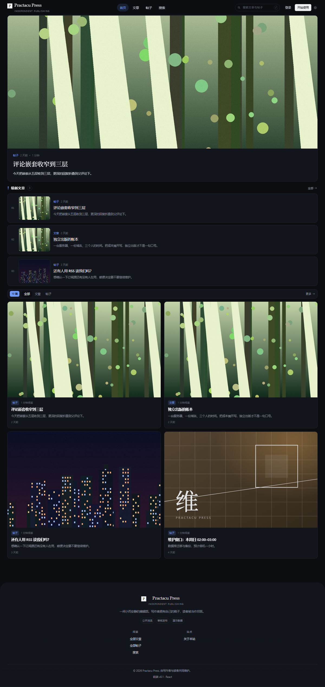
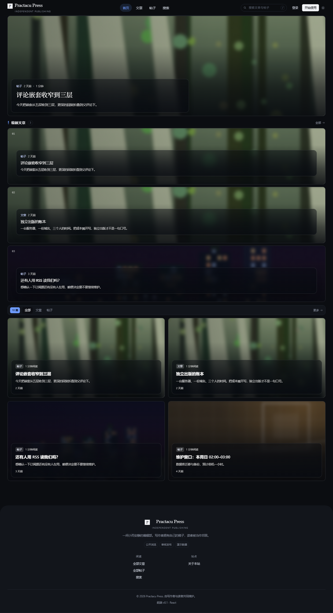

# 2026-11 主题与阅读体验修订

这次修订把「白昼」并回夜航，保留它的明亮观感，同时清掉第三个大主题带来的分叉。站点现在只有两套内置大主题：**原版**（纸白、单栏）与**夜航**（冷石墨、双栏）；夜航的浅色模式就是原来的白昼纸面，明暗开关只切模式，不再切主题。

## 主题

- 移除内置主题 `daylight` 与配色预设 `daylight`。
- 旧配置里的 `preset: "daylight"` 在读取时折算为 `night`；`variant: "daylight"` 仍被保留，已有白昼版式的站点不会塌版。
- 夜航换成冷石墨 + 电光蓝：深色 `#0b0d11`，浅色 `#f7f8fa`，强调色共用 `#2457f5`（浅色）/ `#6e9bff`（深色）。
- `nf-hero` 不再写死黑底与薰衣草标题：深色是石墨卡，浅色是纸白卡，标题强调色读 `--accent`。

## 明暗偏好

- 新增 `pp_theme` Cookie（`light` / `dark`，一年有效，`SameSite=Lax`）。
- Cookie 优先于站点主题的 `theme.mode`；页头、阅读工具栏、Shift+D 与思维链动作都只改这台浏览器。
- `index.html` 在 React 启动前读取 Cookie 并写入 `<html data-mode>`，避免深色读者刷新时先闪一帧白底。
- 切换时给 `<html>` 加 420ms 的 `pp-theme-tween` 过渡类，颜色与描边一起呼吸；`prefers-reduced-motion` 下降级为瞬时切换。

## 文章页

- 正文列固定 720px，阅读区在视口中居中；右侧栏从文章页移除。
- 宽屏使用三列网格：左侧 196px 目录、中间正文、右侧等宽留白。左右留白相等，因此加目录不会把正文推偏。
- 目录从正文 `h2/h3` 自动生成，`position: sticky` 跟随滚动；当前标题高亮。窄屏隐藏悬浮目录，正文上方显示折叠目录。
- 目录只在「扩展 → 目录」开启时出现。

## 文章列表

- 文章 / 帖子归档页增加「列表 / 卡片」分段开关，选择存 `localStorage`。
- 列表视图保留原有的按年、按月分组；卡片视图按年分组，卡片内包含封面、类型、日期、摘要、作者与阅读时长。

## 首页文章外观

- 夜航的「主题设置」新增「文章外观」，两选一，存在 `layout.article_card_style`：
  - `cover`（默认）：封面在上、文字在下，与改造前完全一致；
  - `blur`：封面铺满整张卡片并高斯模糊，标题、简介与元信息压在卡内的毛玻璃面板上。
- 只作用于首页的「精选文章」「文章列表」「文章卡网格」；置顶 / 热门网格本来就以封面铺底，不改。
  首屏双卡、分类胶囊与侧栏组件不受影响。
- 模糊卡片固定深色底 + 白字，压暗渐变保证任意封面可读；浅色模式下同样是深色图片卡。
- 缺省 / 未知值回退 `cover`，旧站点升级后观感不变；设置随站点设计快照同步与导出。
- 组件在 `apps/web/src/components/blocks/Nightflight.tsx`（`useBlurCards`），样式在
  `apps/web/src/styles.css` 的「文章卡的第二外观：模糊封面」一段。

| 封面在上（默认） | 模糊背景 |
| --- | --- |
|  |  |

后台入口与选择状态见 `../assets/2026-11-09-article-style/admin-article-style.png`；
手机端的同一套外观见 `../assets/2026-11-09-article-style/home-blur-mobile.png`。

## 页脚

- 采用白昼的居中报头尾：整块浅色圆角承托，品牌块独占第一行，栏目在下方居中，底栏居中。
- 品牌标记仍沿用 `.brand` / `.brand-mark`，没有换 logo。

## 安装向导

- `SetupPage` 给 `<html>` 打 `data-surface="setup"`，并用 `useLayoutEffect` 在第一帧前落下标记。
- `theme.ts` 与 `siteRefresh.css` 都为安装向导输出固定的纸白令牌；即使浏览器里还留着上一次安装的深色主题，向导也不会出现白底浅字。
- 主题预览的「Aa」用 `readableInk()` 计算对比度，低对比组合退成黑或白。

## 后台

- 页面管理新增「系统页面」快捷卡：首页、文章页、主题设置、外观与页脚。
- `/admin/theme` 支持 `?target=home` 与 `?target=article` 深链。
- 「访问与域名」拆成两个可深链的 Tab：`?tab=access`（默认）与 `?tab=domains`，两块内容各自保存。

## 登录闪屏

原因有两处：`AuthPage` 在 `status` 变 `ready` 的 effect 和提交函数里各导航一次；登录页与后台又分属深色 / 浅色两个 surface。现在：

- 用 `navigatedRef` 保证只导航一次。
- 登录、退出、进出后台的路由跳转包进 View Transition，旧页与新页交叉淡化。
- 站内页面切换在 `SiteChrome` / `AdminShell` 的 Outlet 上使用 `route-transition` 淡入。

## 验收

```powershell
cd apps/web
node node_modules/typescript/bin/tsc --noEmit
node node_modules/vitest/vitest.mjs run
node node_modules/vite/bin/vite.js build   # 若 Windows 临时目录清理失败，先把 TMP 指到工作区
```

截图见 `.tmpbuild/final/`（本地验收产物，不入库）。
